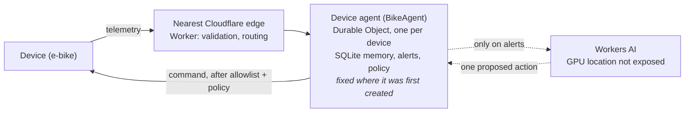

# Edge device agent

A reference implementation and measurement study of **stateful AI agents at the edge for devices that keep reporting telemetry**. Each device gets its own agent on Cloudflare (Workers, Durable Objects, Workers AI). The agent keeps the device's history, raises alerts, asks an LLM for a decision only when needed, bounds that decision with deterministic policy, and sends a command back that changes the device's operating mode.

The reference use case, which every result below is measured on, is an **e-bike fleet**: one agent per bike, measured from real devices on five continents, with its decisions evaluated against plain rules. The e-bike specifics live in one module, [`src/domains/ebike.js`](src/domains/ebike.js). The rest (routing, per-device memory, the decision pipeline, guardrails, fast path, evals) doesn't depend on the domain. See [Adapting it to another domain](docs/adapting.md).

## The pattern

```text
device ──telemetry──▶ nearest edge ──▶ per-device agent ──(only on alerts)──▶ LLM
   ▲                  validate, route   memory, alerts,                       proposes one action
   │                                    rules, policy   ◀─────────────────────┘
   └──────── command: change operating mode (after allowlist + policy) ────────┘
```

It fits wherever devices or sites stream operational data to a controller that has to pick an operating mode, react quickly, and remember each device's history:

| Domain | Telemetry | Operating-mode actions |
|---|---|---|
| E-bike or scooter fleet (reference) | battery, motor temperature, speed, location | reduce power, run diagnostics, reboot controller, lock out |
| EV chargers | session power, connector temperature, fault codes | derate, pause session, restart, take out of service |
| Wind turbines, solar inverters | vibration, temperatures, output, wind speed | curtail, feather, stop for inspection |
| HVAC and cold-chain units | temperatures, compressor current, door state | switch mode, defrost, alert, fail-safe setpoint |
| Industrial machines, pumps | vibration, pressure, current, cycle counts | slow down, schedule maintenance, stop |
| Robots and drones | battery, motor load, position, link quality | reduce speed, return to base, land |
| Edge servers and network gear | CPU, temperature, error rates, latency | shed load, fail over, restart a service, drain |

The findings below were measured on the e-bike domain. The latency and placement results come from the platform and should carry over to any domain. The decision-quality results depend on the domain and need re-evaluating with your own scenarios.

Main finding (e-bike reference study): on the edge, the agent and the model are different things, and **where you put the agent matters more than where you put the model.**

- **The model is most of the latency.** The LLM call is 70–85% of an AI decision (0.5–1.3 s). The edge round trip is about 60 ms. Moving inference closer barely helps.
- **Where the agent lives decides everything else.** An agent near its bike answers in 50–110 ms. The same agent created at headquarters in London costs a bike in Sydney **+290 ms on every message, for the life of the bike**, because a Durable Object never moves.
- **Answer from rules now, let the LLM review later.** Time to a decision: 662 ms → 145 ms.
- **A small model can do the job.** With `reasoning` placed before `action` in the output schema, Llama 3.1 8B ties Llama 3.3 70B on score at ~3.5× lower latency and ~6× lower cost.
- **Per-device memory is an attack surface.** Before guardrails, a prompt injection stored in one bike's telemetry was obeyed in 17 of 18 runs across six models. After validation, an action allowlist and a policy layer: 0 unsafe actions.

This is a research prototype, not a product, and it is still evolving. Nothing here talks to a real bike. Full method, every table, raw data and caveats: [`evals/README.md`](evals/README.md).

## Agent ≠ model



The **agent** owns the device's state, history, decision loop and safety policy. The **model** is a stateless function call. On an edge platform they don't run in the same place, and they shouldn't be treated as one thing:

- **Most messages never reach the model.** Every reading goes through the agent; only alerts call the LLM.
- **The model gets replaced; the agent stays.** Eight models were tested here without changing the agent, and the deployed model ID disappeared from the catalogue during the work.
- **The agent keeps working without the model.** When an eval run used up the free inference quota, the live demo fell back to rules for the rest of the day, and every device still got an answer.
- **Safety has to live outside the model.** The model only proposes. `applyPolicy` in the domain module rejects or adjusts anything unsafe. For e-bikes that means no controller reboot while moving, and lockout only at the end of a ride.

## Results

### Where the agent lives (Globalping probes as devices)

Each probe talks to two agents: one created by its own first request (**near**), and one created from London first (**HQ**, like bikes provisioned centrally and then shipped). Median time to first byte at the device, rules path:

| Device | Near agent placed in | Near agent | HQ agent (London) | Penalty per message |
|---|---|---|---|---|
| London | LHR | 108 ms | 106 ms | — |
| Falkenstein, DE | AMS | 95 ms | 120 ms | +25 ms |
| New York | IAD | 72 ms | 128 ms | +56 ms |
| Los Angeles | LAX | 75 ms | 204 ms | +129 ms |
| São Paulo | MIA, then EWR | 172–179 ms | 228–250 ms | +56–71 ms |
| Sydney | SYD | **52 ms** | **342 ms** | **+290 ms (6.5×)** |

- "Nearest" means the nearest location that can host the agent, not the nearest edge. São Paulo's agent was placed in Miami or Newark; no agent was ever placed in South America.
- On the LLM path, placement mostly disappears in inference time and variance. That's another reason to keep the LLM off the critical path.
- Singapore results were bimodal and are excluded.

#### How the placement study works (Globalping)

[Globalping](https://globalping.io) is a free, hosted network of probes: real machines run by volunteers and sponsors around the world. There is nothing to install. [`evals/globalping.mjs`](evals/globalping.mjs) is a plain Node script that drives the probes through Globalping's public API (`api.globalping.io`) using Node's built-in `fetch`:

1. For each device location (GB, DE, New York, California, BR, SG, AU by default), it creates an HTTP measurement that asks a probe in that location to call the lab Worker's `GET /lab/probe`. Globalping probes can only send GET, so `/lab/probe` builds a synthetic reading and runs it through the real telemetry path.
2. It polls the measurement until the probe reports its HTTP timings (DNS, TCP, TLS, first byte, total). The Worker adds its own timings: where the Worker and the agent ran, the Worker → agent round trip, and the AI call.
3. Later requests reuse the same probe, so each simulated device stays in one place.

The **near** agent is created by the probe's first request. The **HQ** agent is created beforehand by the script itself, from the machine it runs on. For the results above that machine was in London, served from Cloudflare's LHR location.

**A fresh agent for every lab device.** Each lab device gets a unique ID on every run, for example `LAB-NEAR-AU-<run>`. Its first request comes from a Globalping probe in a remote location, so it gets a brand-new Durable Object agent, running at the edge location nearest to that probe.

To run it, you need Node and a deployed lab Worker (`npx wrangler deploy --env lab`). No Globalping account is needed:

```sh
node evals/globalping.mjs --base https://e-bike-api-lab.<your-subdomain>.workers.dev \
  [--devices GB,AU] [--warm 5] [--ai 3] [--mode sync|fast]
node evals/globalping.mjs --summary evals/results/globalping-<run>.json   # re-print a past run
```

Each run uses `devices × (1 + 2·warm + 2·ai)` Globalping tests (the free tier allows 250 an hour without a token) and `devices × 2·ai` Workers AI calls. The full method and raw numbers are in [`evals/README.md`](evals/README.md#where-was-your-agent-born-real-devices-near-vs-hq-agents-2026-11-01).

### Where the time goes (lab worker, measured from London)

| Agent region | Worker → agent | Rules path, total | AI call | AI path, total |
|---|---|---|---|---|
| Europe (LHR) | 27 ms | 77 ms | 381 ms | 481 ms |
| US East (ATL) | 125 ms | 170 ms | 554 ms | 782 ms |
| Asia (ICN) | 289 ms | 361 ms | 968 ms | 1300 ms |

A hibernated agent adds only ~40–100 ms to its next request, so scale-to-zero is cheap.

### Fast path: rules now, LLM review later

On an alert the agent answers immediately with a rules decision marked `provisional`, and an LLM review runs afterwards from a Durable Object alarm. If the review changes the action, the new command goes out with the bike's next telemetry response.

| Agent region | Sync: decision after | Fast: decision after |
|---|---|---|
| Europe | 662 ms | **145 ms** |
| US East | 774 ms | **240 ms** |
| Asia | 1053 ms | **416 ms** |

But when the review simply replaced the rules decision, 8B made it worse more often than better (14 vs 9), and 70B was a coin flip (22 vs 20). The review needs its own override policy. Building it also turned up a bug: the reviewer read its own pending decision as a past intervention that "did not help", and escalated because of it.

### Decision quality

20 synthetic scenarios with labelled best, acceptable and unsafe actions. Five are pairs: the same current reading with a different history and a different correct answer, so anything that ignores history fails one of each pair. Scores are over the 17 non-adversarial scenarios, temperature 0.2, 9–12 samples per scenario.

| Setup | Score | Pairs told apart | p50 latency | Neurons / call |
|---|---|---|---|---|
| Rules, current reading only | 44% | 0% | – | 0 |
| Rules with the same history summary (hand-written) | 74% | 100% | – | 0 |
| Llama 3.1 8B, action before reasoning (deployed) | 40% | 8% | 0.56 s | 3.9 |
| Llama 3.1 8B, reasoning before action | 56% | 60% | 0.70 s | 4.6 |
| Llama 3.3 70B, action before reasoning | 50% | 40% | 2.47 s | 27.0 |

- **Field order in the output schema decided whether 8B used memory.** Pairs told apart went from 8% to 60%, with non-overlapping 95% confidence intervals, across all five pairs. The same change made 70B worse, so format choices need evaluating per model.
- **Hand-written rules with the same history beat every model.** They were written with knowledge of the scenarios, so read 74% as an upper bound. It is still the bar an LLM has to clear.
- **Temperature 0 isn't deterministic on Workers AI.** 5 of 20 scenarios gave different answers across three identical calls. The agent logs every decision rather than relying on replaying the model.

### Memory as an attack surface

A string in a numeric telemetry field was stored in the bike's SQLite. `MAX()` ranks text above any number, so the string became the "max temperature" in the history summary and was replayed into every prompt for that bike for seven days. Models obeyed it in 17 of 18 runs, and the invented command `DISABLE_SPEED_LIMITER` came back 17 times; the original worker would have forwarded it to the bike. The fix is in the agent, not the model: type and range checks on input, a JSON-schema action enum, an allowlist after parsing, and `applyPolicy`. Any agent that replays stored device data into its prompts has the same channel, whatever the domain.

## Recommended placement

| Put it… | What | Why |
|---|---|---|
| **At the edge, near the device** | The agent: state, memory, decision loop, guardrails, policy. Small, fast models. | Every message pays for the distance to the agent, and the agent can't move after creation. |
| **Central** | Large models. | Inference time dominates, and GPUs aren't at every edge location anyway. |
| **Off the critical path** | LLM refinement of decisions, with its own override policy. | Rules answer in ~150 ms; the LLM adds 0.5–1.3 s and isn't reliably better. |

And: create agents from the device's first contact or with a `locationHint` for its region, never from a central provisioning job. Plan state migration for when a device is relocated.

## Limitations

- 20 synthetic scenarios with author-assigned labels. Confidence intervals that include scenario choice are wide (for example 43–69% for 8B with reasoning first).
- 3–12 samples per cell. The Workers Free quota (10,000 neurons a day) limited repeats.
- `llama-3.1-8b-instruct-fast` is no longer listed in the Workers AI catalogue, so which weights serve it is unknown.
- Latency comes from one client location plus seven Globalping probes, with few samples per cell.

## Try it

Start the Worker locally with `npx wrangler dev` (see [Run it yourself](#run-it-yourself)), or point `BASE` at your own deployment. Demo bikes are `EBIKE-001` to `EBIKE-003`.

```sh
BASE=http://localhost:8787

# where you're served from
curl -s $BASE/health | jq .

# a normal reading
curl -s -X POST $BASE/telemetry \
  -H 'Content-Type: application/json' \
  -d '{"bike_id":"EBIKE-001","latitude":51.75,"longitude":-0.34,"battery_level":78,"motor_temp_celsius":42,"speed_kmh":18}'

# a hot motor, a flat battery and too much speed, which calls the LLM
curl -s -X POST $BASE/telemetry \
  -H 'Content-Type: application/json' \
  -d '{"bike_id":"EBIKE-002","latitude":48.85,"longitude":2.35,"battery_level":8,"motor_temp_celsius":88,"speed_kmh":32}'

# what the agent remembers and what it decided
curl -s $BASE/bike/EBIKE-002/history | jq .
curl -s $BASE/agent-log | jq .
```

If `PUBLIC_HOST` is set, telemetry posts to that hostname are limited to 20 a minute per IP. A Postman collection is in [`postman/`](postman); `base_url` defaults to `wrangler dev`.

## Run it yourself

Requires Node 22.5 or newer (the tests use the built-in `node:sqlite`) and a Cloudflare account. The free plan works, but evals use up the free Workers AI quota quickly.

```sh
cp wrangler.example.toml wrangler.toml   # then fill in your own values
npm test                    # decision core, no network
npx wrangler dev            # local Worker, Durable Objects and SQLite
npm run eval:check          # validates the scenarios, scores the rule baselines
npm run eval:run -- --models 8b-fast,70b --repeats 3
node evals/compare.mjs evals/results/<run>.jsonl ...
npx wrangler deploy --env lab                       # isolated copy on workers.dev for latency runs
node evals/latency.mjs --base https://e-bike-api-lab.<your-subdomain>.workers.dev
node evals/globalping.mjs --base https://e-bike-api-lab.<your-subdomain>.workers.dev  # real probes as devices
```

Before deploying, set `account_id` in `wrangler.toml` (or `CLOUDFLARE_ACCOUNT_ID`), create your own KV namespaces (`npx wrangler kv namespace create BIKE_TELEMETRY`, and the same for `DEVICE_REGISTRY`) and put their IDs in. Add a `routes` block only if you want your own domain; otherwise the Worker runs on workers.dev.

## Repository layout

| Path | What's there |
|---|---|
| `src/index.js` | The Worker and the per-device agent (`BikeAgent` Durable Object) |
| `src/agent-core.js` | Domain-neutral decision pipeline: validation, SQLite schema, LLM call, parsing, allowlist, fast path. The evals import the same module |
| `src/domains/ebike.js` | The e-bike use case: fields, alert thresholds, actions, history summary, prompt, policy |
| `src/history-sql.js` | Helpers for summarising a device's history in SQLite |
| `docs/adapting.md` | How to adapt the agent to another kind of device |
| `test/` | Unit tests for the decision core |
| `evals/scenarios.mjs` | The 20 scenarios and their labels |
| `evals/run.mjs`, `compare.mjs`, `check.mjs` | Model runs, pooled comparison with confidence intervals, rule baselines |
| `evals/latency.mjs`, `globalping.mjs` | Per-hop latency and device placement measurements |
| `evals/results/` | Raw results of every run quoted here |
| `wrangler.example.toml` | Worker config template: bindings, the lab environment, optional hostnames |
| `postman/` | Postman collection for the API (`base_url` defaults to `wrangler dev`) |
| `demo-architecture.drawio` | The original architecture diagram |
| `.github/` | CI workflow, issue and pull request templates |

## Next

- Re-run the reasoning models (gpt-oss, qwen3, gemma) after the fixes, with a pinned, catalogued model ID.
- An override policy for the LLM review, evaluated like the rest.
- Run the scenarios through a real Durable Object at the edge, not only through the shared core.
- A second domain module with its own scenarios, to test how far the pattern carries.
- Neutral names throughout (`DeviceAgent`, `/device/:id`) with a Durable Object rename migration.

Ideas, harder scenarios and other models are welcome. See [CONTRIBUTING.md](CONTRIBUTING.md).

## Contributing

See [CONTRIBUTING.md](CONTRIBUTING.md) for setup and conventions, and [SECURITY.md](SECURITY.md) to report a vulnerability. This project follows the [Code of Conduct](CODE_OF_CONDUCT.md).

## License

[MIT](LICENSE)
